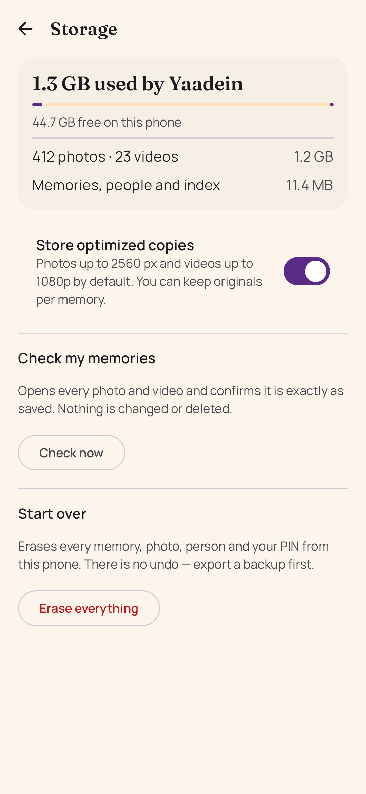
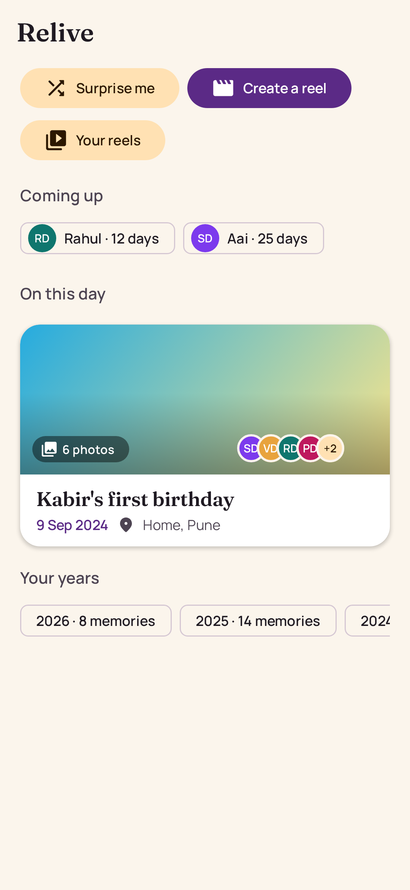
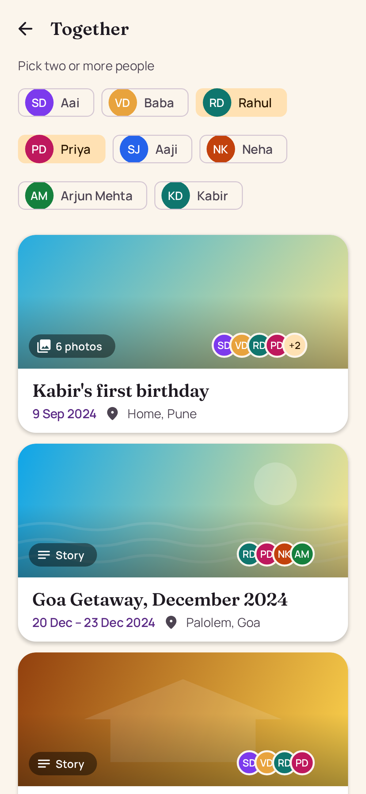

# Screenshots

Generated by Compose Preview Screenshot Testing (`./gradlew :app:updateDebugScreenshotTest`). Previews live in `app/src/screenshotTest`.

## CapturePreviews

### Capture hub

### Event capture

### Group editor

### Fill in the past

### Photo first drafts

### Quick capture

### Storage

### Text only with polish

## RecapPreviews

### Recap setup

## RelivePreviews

### Notification settings

### Relationships map

### Relive

### Security settings

### Together

### Yearly summary

## ScreenPreviews

### Empty timeline

### Lock screen

### Memory detail phone

### Memory detail tablet

### Onboarding

### People phone

### People tablet

### Person story phone

### Timeline Easy mode

### Timeline Festive

### Timeline Midnight

### Timeline phone dark

### Timeline phone

### Timeline tablet

